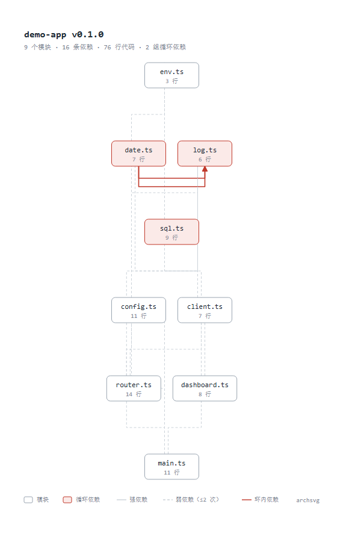

# archsvg

**一条命令，把仓库的模块结构变成一张能直接嵌进 README 的架构图，并且每次改代码它都跟着更新。**

手写架构图一周后必然过期。archsvg 从代码里推导真实依赖，输出确定性的 SVG，顺带把"架构漂移"变成 CI 能拦住的检查。

```bash
git clone https://github.com/onlkwu/archsvg.git
node archsvg/bin/cli.mjs /path/to/your-repo --out docs/architecture.svg
```

零依赖，Node 20+ 即可，不需要安装任何东西。



> 上图由本仓库的 `demo/` 目录生成：`node bin/cli.mjs demo --out docs/architecture.svg`
> 矢量版见 [docs/architecture.svg](docs/architecture.svg)（同一张图，可由 `npm run svg` 重新生成）

---

## 为什么不是又一个画图工具

| | 手写 Mermaid / D2 | archsvg |
|---|---|---|
| 图的来源 | 手工维护 | 从 import 推导 |
| 代码改了 | 图烂掉，没人发现 | 重新生成即可 |
| 位置稳定性 | 手工调 | **同一 commit 永远产出同一串字节** |
| 能不能拦住坏依赖 | 不能 | `--check` 直接让 CI 失败 |

位置稳定这一点是它能进 CI 的前提：如果每次生成图都长得不一样，diff 里全是噪音，没人会把它提交进仓库。

## 它长什么样

```
$ node bin/cli.mjs . --out arch.svg
模块 9 个 · 依赖 16 条 · 外部包 0 个
发现 1 组循环依赖：
  - src/utils/date.ts → src/utils/log.ts
已写入 arch.svg
```

## 安装与使用

零运行时依赖，Node 20+ 即可，不需要构建步骤。

```bash
git clone https://github.com/onlkwu/archsvg.git

# 在目标仓库里直接跑（路径按实际情况替换）
node /path/to/archsvg/bin/cli.mjs . --out docs/architecture.svg

# 也可以装成全局命令
cd /path/to/archsvg && npm link
archsvg . --out docs/architecture.svg
```

| 选项 | 说明 |
|---|---|
| `--out <file>` | 写入文件（默认输出到 stdout，所以 `> arch.svg` 也能用） |
| `--format svg\|html\|json` | 输出格式，`--json` 是 `--format json` 的简写 |
| `--check --rules <file>` | 执行架构规则检查，有违规时退出码 1 |
| `--group-dir` | 按目录聚合成模块级视图 |
| `--group-depth <n>` | 聚合深度，默认 2 |
| `--max-nodes <n>` | 节点数上限，超出自动聚合，默认 400 |
| `--lang js,ts,py` | 只分析指定语言；非法值会被拒绝（可选 `js` / `ts` / `py` / `generic`） |
| `--ignore <glob>` | 额外忽略项，可重复。写法统一归一化：`./lib/`、`/lib/`、`lib\`、`lib` 等价；`packages/*/src` 与 `packages/*/src/` 等价 |
| `--include-tests` | 把测试文件也画进图（默认排除） |
| `--strict` | 存在无法解析的导入时退出码非 0 |
| `--quiet` | 不打印摘要与帮助性输出（**警告与 `--check` 结论仍会输出**，见下方说明） |

**退出码**：`0` 正常 / `1` 有架构违规或 `--strict` 下解析失败 / `2` 输入错误。

短选项：`-h`（帮助）、`-v`（版本）、`-o <file>`（等价 `--out`）、`-`（当前目录）。

取值约定：`--out=x` 与 `--out x` 等价；显式空值（`--out=`）会报错而不是静默丢弃；`--` 会终止选项解析，之后的一切都是位置参数（需要传以横杠开头的路径时用它）；上限类参数必须是 ≥ 1 的整数，写 0 或负数会被拒绝——否则会得到一个"看起来正常但其实是错的"空图或过度聚合的图。

## 输出格式

- **SVG**：单文件，能直接嵌进 README，也能进文档站。尺寸固定，不依赖任何字体文件。右下角会列出被依赖最多的几个外部包——外部包在图上是折叠节点、不参与布局，不写出来就完全看不见
- **HTML**：单文件，带统计与循环依赖面板，适合贴给别人或全屏看。所有内容都做 XML 转义，可以安全地把不可信的文件名/规则消息渲染进去
- **JSON**：给 CI 和上层工具用，schema 见下

```json
{
  "schemaVersion": 1,
  "root": "/abs/path",
  "stats": { "nodeCount": 9, "edgeCount": 16, "cycleCount": 1, "grouped": false },
  "nodes": [{ "id": "src/main.ts", "label": "main.ts", "lines": 11, "inDeg": 0, "outDeg": 4, "x": 103.2, "y": 754 }],
  "edges": [{ "from": "src/ui/dashboard.ts", "to": "src/db/client.ts", "weight": 1, "isCycle": false, "refs": [{ "file": "src/ui/dashboard.ts", "line": 2 }] }],
  "cycles": [["src/utils/date.ts", "src/utils/log.ts"]],
  "violations": []
}
```

## 架构检查：从"好看"到"有用"

纯画图工具会停在几百星。让它能拦住 PR，才会被长期留在 CI 里。

```bash
node bin/cli.mjs . --check --rules rules.json --out docs/architecture.svg
```

```json
{
  "schemaVersion": 1,
  "rules": [
    {
      "id": "ui-not-db",
      "from": "src/ui/**",
      "to": "src/db/**",
      "forbidden": true,
      "message": "ui 层不应直接依赖 db 层，请经过 api 层"
    }
  ]
}
```

违规会报到文件与行号级别，而不是只告诉你"某层依赖了某层"：

```
架构违规 1 处：
  ✗ src/ui/dashboard.ts:2  ui 层不应直接依赖 db 层，请经过 api 层  [ui-not-db]
```

规则文件的完整示例见 [`rules.example.json`](rules.example.json)。因为它是普通 JSON 而不是 DSL，加一条规则的成本是几行文本——这是规则库能被别人一起维护的前提。

## 支持的输入

| 语言 | 解析内容 |
|---|---|
| **JS / TS** | `import`、`export ... from`、`import()`、`require()`；`tsconfig` / `jsconfig` 的 `baseUrl` 与 `paths` 别名（含 JSONC 注释、尾逗号、`extends` 链式继承）；`package.json` 的 `imports` 字段（`#` 开头的仓库内别名） |
| **Python** | `from x import y`、`import a.b`、相对导入（按点数上溯）、括号折行导入、包（`__init__.py`）作为导入目标 |
| **C / C++** | `#include "..."` 相对当前文件解析；`#include <...>` 视为系统头文件不参与画图 |

有意为之的几个决定：

- **标准库不算依赖**。Python 的 `os` / `json` 和 Node 的 `fs` / `path` / `node:fs` 都不进图，否则任何仓库的图都会被噪音填满
- **外部包折叠成一个节点**。`express` 只出现一次，不展开成几十个文件
- **tsconfig 按"离文件最近的"来选**。monorepo 里每个包用自己的别名，`packages/a` 的 `@core/*` 不会泄漏到 `packages/b`
- **`#` 别名按"离文件最近的、定义了 imports 的 package.json"解析**，目标路径相对该 package.json 所在目录。找不到映射时记为 unresolved 而不是外部包——否则图上会冒出一个名叫 `#utils` 的假第三方库
- **`extends` 会被跟随**（含链式，基配置的别名基准仍在基配置所在目录）。指向 npm 包形式（`@tsconfig/node20`）的 `extends` 不跟随，因为那需要读 `node_modules`——但会明确打一条警告，而不是默默让别名解析失败
- **路径写法统一归一化**。`--ignore` 与规则里的 `from`/`to` 都接受 `./src/ui/**`、`/src/ui/`、`src\ui\` 这类写法，与规范写法完全等价——规则静默失效比规则报错更危险，因为用户会以为架构被守住了
- **`--quiet` 不压警告，也不压 `--check` 的结论**。别名没解析出来时图上会冒出一堆"外部包"，如果连提示都没有就完全无从排查；同理，把检查结论静默掉等于让这条命令失去意义。所以警告始终输出（同一 code+文件只打一次），`--check` 的通过/违规结论也始终输出
- **Python 的搜索根按 Python 的规则算**。从文件目录往上找 sys.path 根，所以包内绝对导入（`from app.core import x`）和同目录脚本互引都能解析，同时不会越出仓库根去连不相干的同名目录
- **测试文件默认排除**。`--include-tests` 可以打开
- **不用 AST，用保守正则**。架构图能容忍漏一条边，不能容忍假边；正则的失败模式可预测，AST 的失败模式是崩溃

## 设计取舍

**分层而不是力导向。** 力导向布局更好看，但同一仓库跑两次位置就不同，每次提交的 SVG diff 都面目全非。archsvg 用确定性的 Sugiyama 式分层：环先用 Tarjan 算法缩点，再按最长路径分层，层内用中位数法减少交叉，最后整体镜像让依赖箭头朝下。

**手写 SVG 而不是引 d3 / elkjs。** 零依赖意味着克隆下来就能跑，不用先装一堆东西，也没有供应链风险；输出体积也能小一个数量级（几百个节点的图约 145KB）。同时完全掌控确定性——所有坐标量化到 0.1，所有集合遍历前显式排序，SVG 里不含时间戳。

**节点大小 ≈ 代码行数。** 图的疏密本身就在传递信息，不需要额外看图例。

**超大单层会折行。** 一个层里塞几百个孤立文件会得到一张 5000px 宽的图，在 README 里等于不可读，所以超过阈值就折成网格。

## 局限（诚实版）

- **不做跨语言依赖**。TS 调用 Python 脚本这类关系它看不见
- **不解析动态导入的拼接字符串**。`import('./' + name)` 会被忽略
- **不做类型层面的分析**。它画的是文件级依赖，不是类型图
- **C++ 的宏和条件编译不展开**
- **规则只能约束仓库内部的依赖**。`to` 写成包名（`express`）目前不会命中，因为外部包在图上是折叠节点、不参与规则匹配
- **只支持禁止型规则**。没有 severity / allow 型（"只有这些文件可以依赖 X"）的表达
- **不自动改代码**。`--check` 只会让 CI 失败，修复由人决定

## 开发

```bash
node --test "test/*.test.mjs"   # 221 个测试
npm run check                   # 语法检查
npm run svg                     # 重新生成 docs/architecture.svg
npm run check:svg               # 检查图有没有画到画布外
npm run stress                  # 全部 8 个鲁棒性测试套件
```

`demo/` 是一个刻意做坏的小应用：跨层违规依赖、互相引用的循环依赖、一个自环、一个被默认排除的测试文件。它同时充当 README 配图和数据来源。

关于自环的准确行为：自己引用自己的文件会被算作一组环（`--json` 的 `cycles` 里能看到，`demo/src/utils/sql.ts` 就是），但不会画成弧线——自指边在图上不表达任何结构信息。

测试里有几条是"回归高发区"专用，改动布局或解析时请留意：确定性（同一输入字节级一致）、所有几何落在画布内、显示名不可重复（重名文件必须补目录前缀）、glob 的 `**` 在开头要能匹配零层目录、解析失败必须是 `unresolved` 而不能伪装成外部包。

`tools/stress*.mjs` 是 9 个按需手动跑的鲁棒性测试套件（不在默认套件里，共 300+ 项断言）：

| 套件 | 覆盖 |
|---|---|
| `stress.mjs` | 确定性（连跑 20 次比对哈希）、敌意文件名、3000 文件规模、3000 层依赖链、错误输入 |
| `stress2.mjs` | 多环共存、软链、入度热点、模式文件、空仓库与单文件仓库、几何越界 |
| `stress3.mjs` | 真实包（npm 自带源码等）上校验报告自洽：每条内部依赖必须指向真实文件、refs 行号必须落在导入语句上 |
| `stress4.mjs` | 现代模块写法：`#` 别名、多 tsconfig、BOM/CRLF、同名文件与目录、软链指向仓库外 |
| `stress5.mjs` | 规则引擎与 CLI：违规是否报到文件级、重叠规则、pattern 各种写法、200 条规则的性能 |
| `stress6.mjs` | 命令行输入异常：缺值、空值、非法数字、`--` 分隔符、以横杠开头的路径 |
| `stress7.mjs` | 静态自检：颜色常量引用、`--lang` 白名单与实现是否一致、help 与默认值、死代码与未使用的 import |
| `stress8.mjs` | HTML 注入面与标签配对、CLI 错误路径、残缺 report、三种格式的产物矩阵 |
| `stress9.mjs` | 文档卫生：面向读者的文档里不应出现建仓/推送/发布阶段的操作记录、本机绝对路径、失效的文件引用 |

```bash
npm run stress          # 全跑
node tools/stress3.mjs  # 单跑某一个
```

## 贡献

规则库是这个项目最需要别人参与的部分，而加一条规则只需要在 JSON 里多写几行——不需要懂布局或渲染。完整格式见 [`rules.example.json`](rules.example.json)。

发现"工具没认出某个依赖"或"规则没生效"这类问题时，请把最小复现的目录结构贴进 issue：`--json` 的输出已经包含了解析结果，通常足够定位。

## License

MIT
